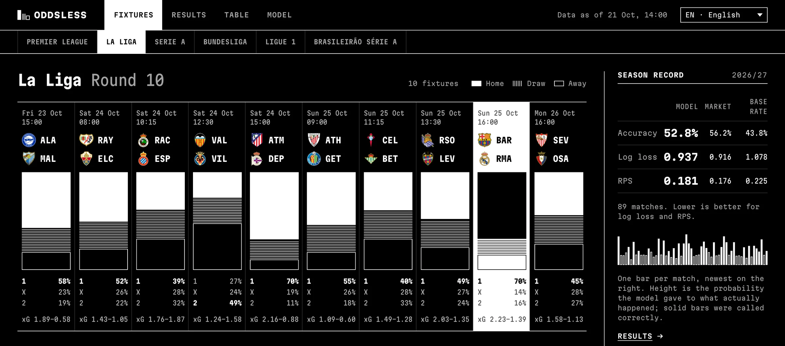
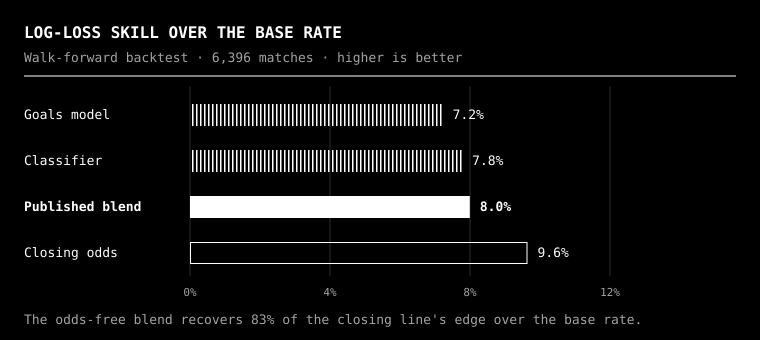
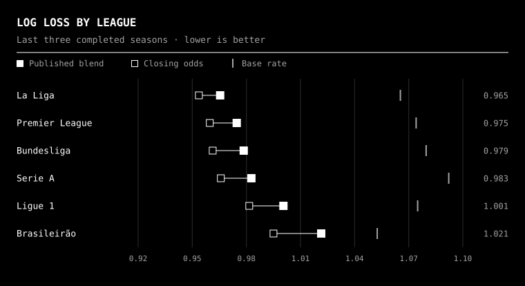
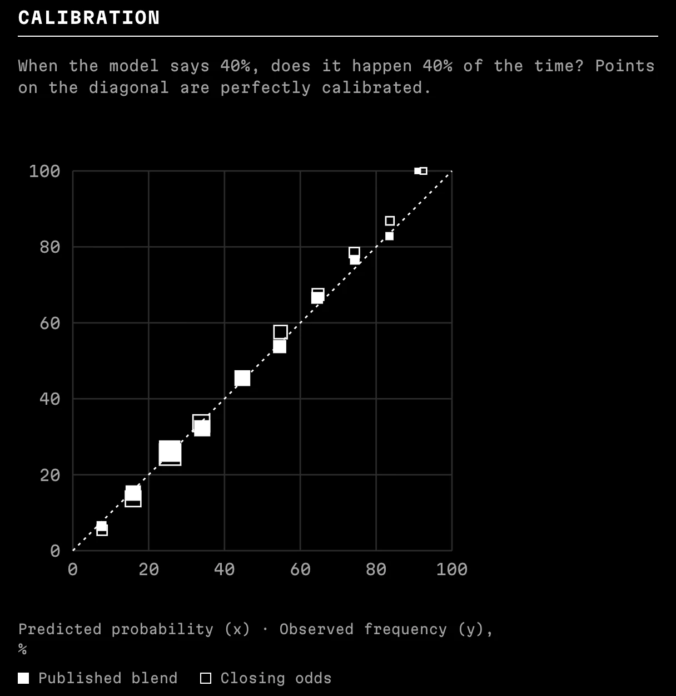
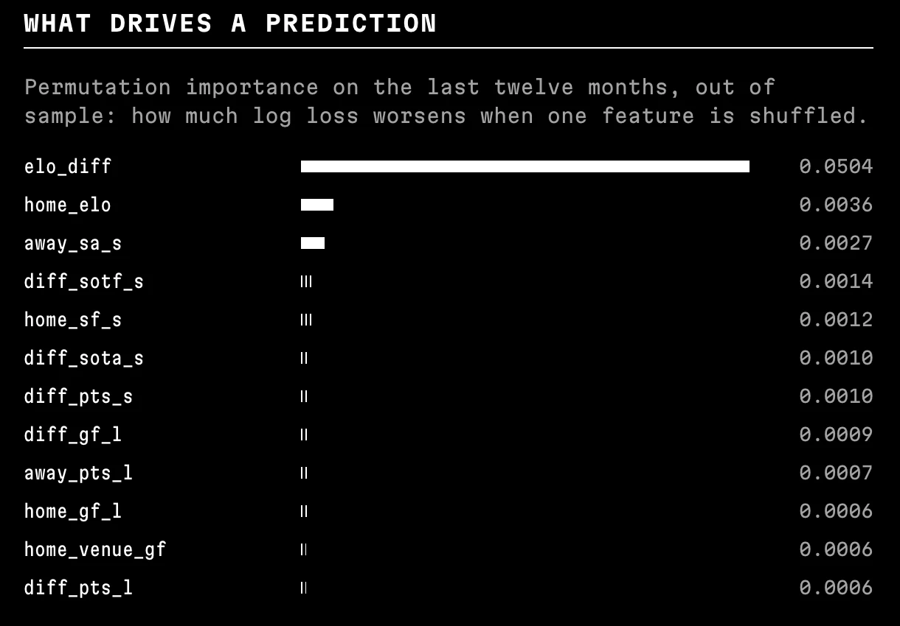
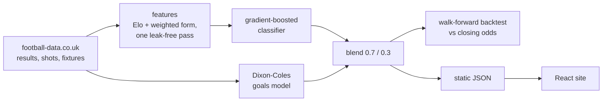
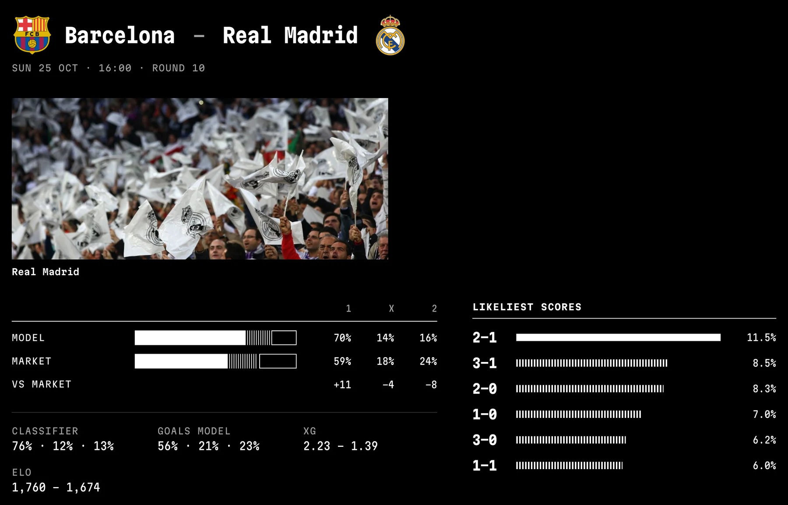

# Oddsless

**Football match predictions for six leagues, from a model that never sees betting odds, and is
scored against them in public.**

[](https://oddsless.netlify.app)
[](https://github.com/amtrevisan/oddsless/actions/workflows/ci.yml)
[](https://github.com/amtrevisan/oddsless/actions/workflows/predictions.yml)


[](https://oddsless.netlify.app/la-liga)

|  44k matches  |  6 leagues  |  6,396 backtested predictions  |  refreshed 4× a day  |  6 languages  |
| :---: | :---: | :---: | :---: | :---: |

Premier League · La Liga · Serie A · Bundesliga · Ligue 1 · Brasileirão. The UI is available in
English, Spanish, Italian, German, French and Portuguese.

## How well it predicts

Every number below comes from a **walk-forward backtest**: each match was predicted using only
data available before kick-off. The bookmakers' closing line is the benchmark, and it is the
hardest public one there is.

<p align="center"></p>

|  | Log loss ↓ | RPS ↓ | Accuracy |
| --- | :---: | :---: | :---: |
| Base rate | 1.073 | 0.229 | 43.9% |
| **Published blend** | **0.987** | **0.200** | **52.3%** |
| Closing odds | 0.969 | 0.194 | 54.1% |

<p align="center"></p>

<table>
<tr>
<td width="50%"></td>
<td width="50%"></td>
</tr>
<tr>
<td>When it says 40%, it happens about 40% of the time, about as well calibrated as the market.</td>
<td>Elo difference does most of the work; shot and form features refine it.</td>
</tr>
</table>

## How it works



- **Features without leakage.** One chronological pass records each team's Elo and
  exponentially weighted form *before* every match, and only then applies the result.
- **Two models, blended.** A scikit-learn `HistGradientBoostingClassifier` pooled across leagues,
  plus a per-league, time-weighted Dixon-Coles goals model fitted with an analytic gradient.
  The blend weight is chosen on a held-out season.
- **Honest evaluation.** Dixon-Coles refits weekly and the classifier retrains every six months,
  scored with log loss, RPS and Brier against the market and a base rate.
- **No servers.** A scheduled GitHub Actions job runs the pipeline, commits versioned JSON when
  it changes, and Netlify redeploys. No database, no API keys.

The full write-up is in [docs/model.md](docs/model.md).

## Up close

Each fixture opens into the model's 1X2 probabilities next to the market's, the two component
models, expected goals and the likeliest scorelines.

[](https://oddsless.netlify.app/la-liga)

## Stack

| | |
| --- | --- |
| **ML / data** | Python 3.12, pandas, scikit-learn, SciPy, uv, pytest, ruff |
| **Frontend** | React 19, TypeScript (strict), Vite, TanStack Query, React Router, CSS modules, Vitest |
| **Infra** | GitHub Actions (CI + scheduled refresh), Netlify |

```
backend/src/predictor/   data · features · models · evaluation · export · pipeline
frontend/src/            views · components · i18n (6 locales) · typed data contract
docs/model.md            modelling and evaluation write-up
```

<details>
<summary><b>Run it locally</b></summary>

```bash
# backend: full refresh in about 20 s, writes ../frontend/public/data
cd backend && uv sync
uv run predictor run              # add --no-media to skip image lookups
uv run pytest

# frontend
cd frontend && npm ci
npm run dev                       # http://localhost:5173
npm test
```

</details>

## Credits

Match data from [football-data.co.uk](https://www.football-data.co.uk). Crests and photography
from [TheSportsDB](https://www.thesportsdb.com); club crests are trademarks of their clubs.
Probabilities are model estimates, not betting advice.

---

Designed and built by **Alex Morales Trevisan** ·
[LinkedIn](https://www.linkedin.com/in/alex-morales-dev/) ·
[GitHub](https://github.com/amtrevisan) ·
[YouTube](https://www.youtube.com/@alexmoralesdev)
