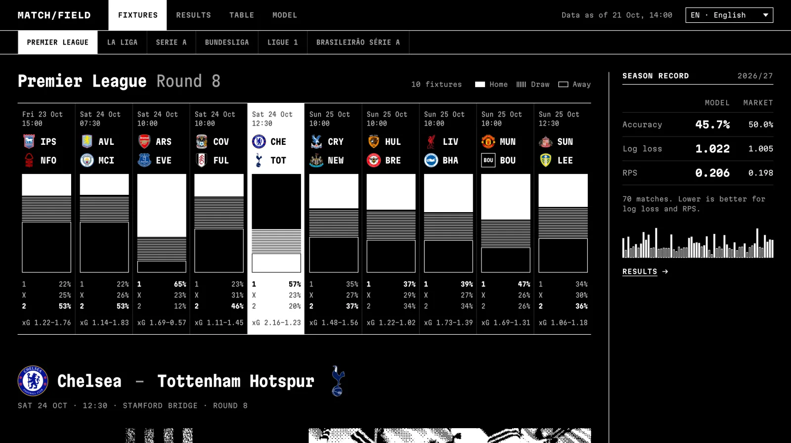
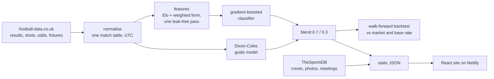

# Matchfield

Win, draw and loss probabilities for every upcoming match in six football leagues, from a model
that never sees betting odds, scored honestly against them.

**Live:** [laligapredictor.netlify.app](https://laligapredictor.netlify.app)



Premier League · La Liga · Serie A · Bundesliga · Ligue 1 · Brasileirão Série A — in English,
Spanish, Italian, German, French and Portuguese.

## What it does

- Predicts home / draw / away probabilities, expected goals and the likeliest scorelines for the
  next round of each league.
- Publishes a season-to-date track record where every past prediction was made before kick-off,
  compared with the closing betting line and a base-rate baseline.
- Shows the full backtest, calibration and feature importance on the Model page.

## Results

Walk-forward backtest over the last three completed seasons of all six leagues
(6,396 matches, every prediction made with data available before kick-off):

| | Log loss ↓ | RPS ↓ | Accuracy |
| --- | --- | --- | --- |
| Base rate | 1.073 | 0.229 | 43.9% |
| Dixon-Coles only | 0.995 | 0.202 | 52.1% |
| Classifier only | 0.989 | 0.200 | 52.2% |
| **Published blend** | **0.987** | **0.200** | **52.3%** |
| Closing odds (market) | 0.969 | 0.194 | 54.1% |

The blend beats every component and the base rate and sits about 0.02 log loss behind the
closing line, which is what you'd expect from a model with no access to odds, team news or
lineups. The site keeps these numbers current; [docs/model.md](docs/model.md) explains the method.

## How it works



1. **Ingest** — `data/` downloads and caches the free football-data.co.uk CSVs (2005/06 onward,
   2012 for Brazil) and normalises them into one table with UTC kick-off times.
2. **Features** — `features/` walks every match in order, recording each team's Elo and
   exponentially weighted form *before* the match and only then applying the result.
3. **Models** — a `HistGradientBoostingClassifier` pooled across leagues and a per-league,
   time-weighted Dixon-Coles model, blended with a weight picked on a held-out validation season.
4. **Evaluate** — `evaluation/` refits Dixon-Coles weekly and retrains the classifier every six
   months, so each evaluated prediction only uses earlier data.
5. **Publish** — `export.py` writes versioned JSON to `frontend/public/data`; a scheduled
   GitHub Actions job commits it when it changes, which redeploys the site.

## Repository layout

```
backend/              Python package (uv)
  src/predictor/
    data/             download, normalise, team names
    features/         Elo and form, leak-free
    models/           classifier, Dixon-Coles
    evaluation/       metrics, walk-forward backtest
    media.py          TheSportsDB crests, photos and meetings (cached in data/)
    pipeline.py       end-to-end run
    export.py         JSON contract
  tests/
frontend/             React 19 + TypeScript + Vite
  src/views/          fixtures, results, table, model
  src/components/     fixture field, detail band, charts, primitives
  src/i18n/           six locales
  public/data/        generated JSON (committed by CI)
docs/model.md         modelling and evaluation write-up
.github/workflows/    CI and the scheduled data refresh
```

## Running it locally

Backend (Python 3.12 via [uv](https://docs.astral.sh/uv/)):

```bash
cd backend
uv sync
uv run predictor run              # full refresh, writes ../frontend/public/data
uv run predictor run --no-media   # skip TheSportsDB lookups, use cached images
uv run pytest
```

A full run takes about 20 seconds plus image lookups. No API keys are needed.

Frontend (Node 22):

```bash
cd frontend
npm ci
npm run dev        # http://localhost:5173
npm test
npm run build
```

## Deployment

- `.github/workflows/predictions.yml` runs the pipeline four times a day and commits
  `frontend/public/data` and `backend/data` when they change.
- Netlify builds `frontend/` on every push (`netlify.toml`).
- `.github/workflows/ci.yml` lints, type-checks and tests both halves on every push and PR.

## Data and credits

- Match data: [football-data.co.uk](https://www.football-data.co.uk)
- Crests, club photography and match artwork: [TheSportsDB](https://www.thesportsdb.com),
  hot-linked from their CDN. Club crests are trademarks of their respective clubs.
- Probabilities are model estimates, not betting advice.

## Author

[Alex Morales Trevisan](https://www.linkedin.com/in/alex-morales-dev/) ·
[GitHub](https://github.com/AlexMoralesDev)
